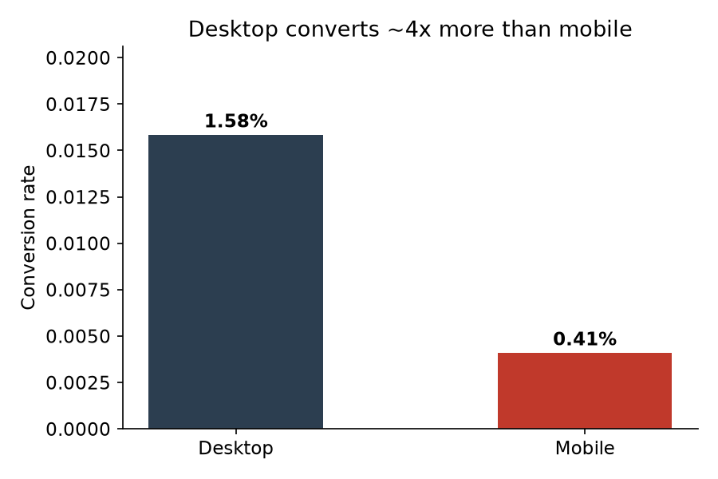
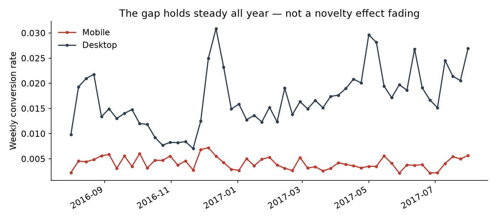
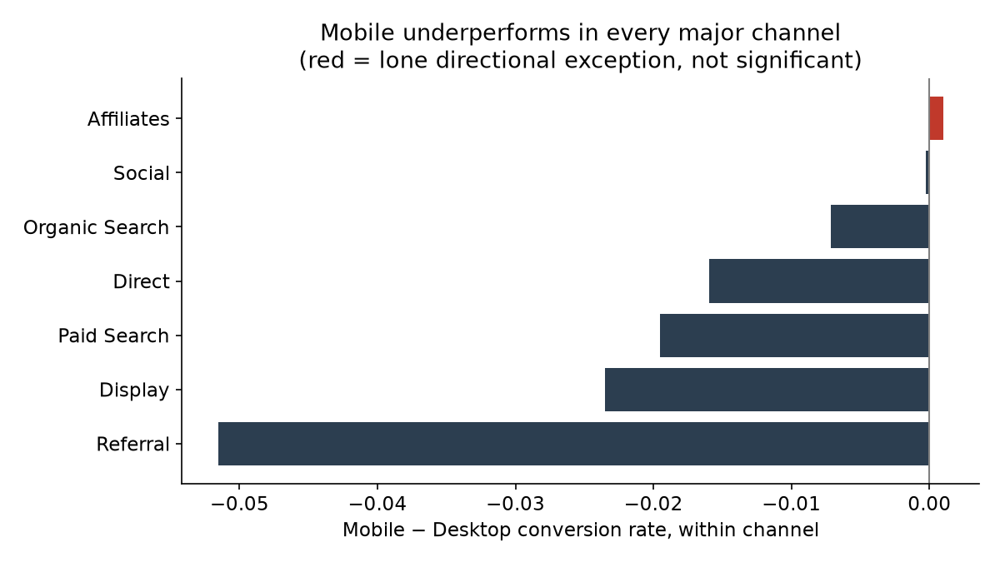
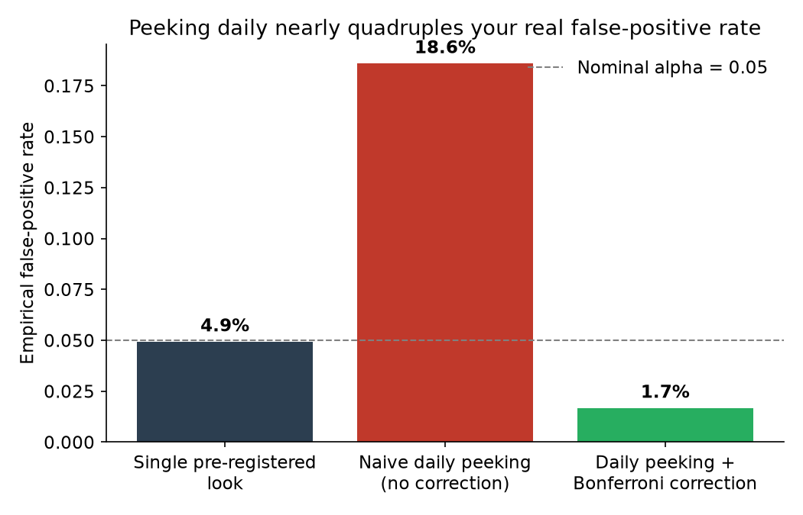

# A/B Test Analysis: Mobile vs Desktop Conversion

**Business question:** Should the Google Merchandise Store fund a mobile-first checkout
redesign?

**Answer:** Yes — mobile converts at roughly a quarter of the desktop rate (0.41% vs.
1.58%), and this gap is real (95% CI: 1.13–1.21 percentage points), stable across the
full year (no novelty-effect decay), and holds within every major traffic channel (no
Simpson's-paradox reversal). But this is observational data, not a randomized test of a
specific redesign — the recommendation is to fund and properly test a redesign, sized
using the a priori power calculation below, rather than skip straight to a full rollout.

Full reasoning and caveats: [`memo/decision_memo.md`](memo/decision_memo.md).

## Key charts

<table>
<tr>
<td width="50%"></td>
<td width="50%"></td>
</tr>
<tr>
<td width="50%"></td>
<td width="50%"></td>
</tr>
</table>

Full executed analysis with all outputs: [`notebooks/01_ab_test_analysis.ipynb`](notebooks/01_ab_test_analysis.ipynb) (renders directly on GitHub).

## Hypothesis

- **H0:** mobile session conversion rate = desktop session conversion rate
- **H1:** mobile session conversion rate ≠ desktop session conversion rate
- **Primary metric:** session-level conversion rate (≥1 transaction)
- Stated before pulling results — see [`notebooks/01_ab_test_analysis.ipynb`](notebooks/01_ab_test_analysis.ipynb).

## Result summary

| Check | Result |
|---|---|
| Sessions analyzed | 664,479 desktop / 208,725 mobile |
| Conversion rate | Desktop 1.58% / Mobile 0.41% |
| Test | Two-proportion z-test |
| Effect (mobile − desktop) | **−1.17 pp** |
| 95% CI | **[−1.21 pp, −1.13 pp]** |
| p-value | ≈ 0 |
| Secondary metric (revenue/session) | Mann-Whitney U (normality rejected by Shapiro-Wilk); same direction, p = 0.003 |
| Novelty effect | Gap does not decay over the year (trend p = 3.5e-5); if anything widens slightly |
| Simpson's paradox | Holds in 6/7 channels; one small channel (Affiliates) reverses direction but not significantly (p = 0.14) |
| Peeking risk | Naive daily peeking inflates false-positive rate to ~19% vs. nominal 5% |
| Power for next test | ~400K sessions/arm needed to detect a 10% relative lift — ~3.8 years at current mobile traffic |

**Decision: fund a mobile redesign effort; run it as a properly randomized, pre-registered test sized per the power calculation above — don't ship on this observational data alone, and don't peek before the analysis date.**

## Why this isn't a "real" randomized A/B test — and what that changes

`bigquery-public-data.google_analytics_sample` has no experiment-assignment flag.
Device type is something visitors chose, not something we randomly assigned, so this is
an **observational quasi-experiment**: the mobile-vs-desktop gap could partly reflect who
tends to shop on which device rather than the device experience itself. This analysis
handles that honestly in two phases instead of dressing an observational comparison up
as a controlled test:

1. **Diagnostic phase:** quantify the historical gap and stress-test it against three
   traps (novelty effect, Simpson's paradox, peeking/multiple-testing inflation).
2. **Prescriptive phase:** use the *observed mobile baseline rate* to run an a priori
   power analysis for a **future, actually randomized** redesign test — the "before you
   build it, here's what a real test costs" calculation.

## Repo structure

```
ab-test-analysis/
├── src/ab_test_analysis/
│   ├── data.py          # BigQuery pulls (aggregated daily/device/channel + revenue sample), cached to CSV
│   ├── power.py         # a priori sample-size calc (statsmodels NormalIndPower + Cohen's h)
│   ├── stats_tests.py   # two-proportion z-test w/ CI; continuous-metric test w/ assumption checks
│   └── traps.py         # novelty trend, Simpson's paradox segment check, peeking simulation
├── tests/                # pytest unit tests for the above (20 tests)
├── notebooks/01_ab_test_analysis.ipynb   # full analysis, executed end to end
├── memo/decision_memo.md                 # one-page business-facing recommendation
├── app/streamlit_app.py                  # interactive segment explorer (optional)
└── data/{raw,processed}/                 # gitignored except cached processed CSVs regenerated by data.py
```

## How to run this

Requires a Google Cloud project with the BigQuery API enabled (free tier: 1 TB of
query processing/month; this project's queries use a small fraction of that).

```bash
# 1. Auth (one-time)
gcloud auth application-default login
gcloud config set project YOUR_PROJECT_ID

# 2. Set up the environment
python3 -m venv .venv
source .venv/bin/activate
pip install -e ".[dev,app]"

# 3. Point data.py at your project (edit PROJECT_ID in src/ab_test_analysis/data.py)

# 4. Run the analysis
jupyter lab notebooks/01_ab_test_analysis.ipynb

# 5. Run tests
pytest

# 6. (Optional) launch the interactive explorer
streamlit run app/streamlit_app.py
```

## What I'd do with more time

- Run the actual randomized redesign test this analysis is sized for, rather than
  stopping at the observational diagnosis.
- Add propensity-style adjustment (e.g. matching on session depth, referrer, or
  landing page) to narrow the "is this really about the device, or who uses it"
  concern beyond the channel-level check already done.
- Extend the Simpson's-paradox check to a second dimension (e.g. device x new-vs-returning
  visitor) to see if any other segment reverses the effect.
- Add a proper group-sequential/alpha-spending design (e.g. O'Brien-Fleming) to the
  `traps.py` peeking simulation, instead of only comparing naive vs. Bonferroni.
