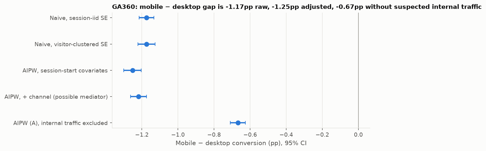

# xpkit: experimentation and causal inference you can defend

<!-- Generated by scripts/build_docs.py from results/**/*.json. Edit docs/templates/README.md.j2, not this file. -->

A tested Python toolkit and three real-data case studies. It covers checking whether an experiment can be trusted, measuring effects with honest uncertainty, estimating what is possible when you *can't* randomize, deciding who to target, and turning each result into a business decision. Every estimator is checked against a trusted reference implementation (scipy, statsmodels, published tables), a simulation with a known true effect, or both. Every number below is generated by code in this repo.

**Verified results**

- **Peeking control:** checking a test at 10 interim looks and stopping at the first p < 0.05 produced false positives in **19.2%** of null experiments. The O'Brien-Fleming boundaries implemented here held it at **5.0%**, kept 78.5% power (vs 80.0% for a single look) and stopped at 77% of the planned sample on average (100,000 simulations).
- **CUPED:** with a pre-period covariate correlated ρ = 0.88 with the outcome, variance fell by **75%** (theory: 77%) with no detectable bias (+0.0010 ± 0.0011) and 95.0% CI coverage.
- **Targeting (Criteo, 400,783 held-out users):** targeting the top 20% by predicted uplift earns **$6.74 per 1,000 users** versus $0.22 for random targeting at the same depth, under stated cost assumptions.
- **Re-examining the original analysis (GA360):** traffic that looks internal (almost all of it one desktop-only referral segment) accounts for 49% of desktop conversions. Excluding it shrinks the adjusted mobile-desktop gap from -1.25 pp to **-0.67 pp**. The original "mobile converts at a quarter of desktop" headline overstated the gap, which was observational to begin with.



**Run it** (Python ≥ 3.10, no credentials, no downloads, about a minute):

```bash
git clone <this repo> && cd rigorous-ab-testing
python -m venv .venv && source .venv/bin/activate
make install && make demo     # trust-checked reports + quick validation runs
make app                      # interactive workbench (Streamlit)
```

---

## For reviewers: what's here and how far to trust it

### Contents

| Module | What it does | Validated against |
|---|---|---|
| `xpkit.sim` | Seeded simulators with known truth: binary/continuous outcomes, pre-period covariate, HTE, SRM, measured and unmeasured confounding, DiD panels with AR(1) errors and trend violations. Monte Carlo harness reporting bias, RMSE, coverage, FPR/power, SE calibration, each with MC SEs. | Analytic truth (tests) |
| `xpkit.trust` | Chi-square SRM test; standardized-mean-difference balance | scipy `chisquare` |
| `xpkit.design` | Sample size, MDE and power for proportions and means, including CUPED | statsmodels power |
| `xpkit.estimate` | Newcombe CI for proportions, Welch and cluster-robust means, delta-method lift, CUPED, Lin (2013) adjustment, Holm/BH, Lan-DeMets group-sequential boundaries (numerical integration) | statsmodels, scipy, published gsDesign tables |
| `xpkit.causal` | Logistic and cross-fitted GBM propensity scores, overlap diagnostics, Hajek IPW with stacked-sandwich or (cluster) bootstrap SE, AIPW with influence-function SE, TWFE DiD with clustered SE, event study with pre-trend test, E-values | statsmodels dummy regressions; simulation |
| `xpkit.uplift` | T- and X-learners, Qini and uplift curves vs random, bootstrap Qini CI, costed targeting policy with depth chosen on validation data | simulation with true τ |
| `xpkit.report` | `xpkit-report data.csv config.yaml -o report.html`: trust checks first, a DO-NOT-INTERPRET banner and exit code 3 when one fails | tests |

### Validation results (simulation, known truth)

| Method | Scenario | Bias | 95% CI coverage | Rejection rate |
|---|---|---|---|---|
| Welch diff in means | null, n=2,000 | -0.00191 | 95.0% | 5.0% |
| Welch diff in means | effect 0.15, n=2,000 | -0.00113 | 95.0% | 59.4% |
| Diff in proportions, Newcombe CI | null, n=10,000, base rate 5% | -0.00015 | 95.2% | 4.8% |
| Diff in proportions, Newcombe CI | effect 0.01, n=10,000, base rate 5% | +0.00005 | 94.9% | 58.8% |
| Diff in proportions, Newcombe CI | null, n=600, base rate 1% | -0.00003 | 97.2% | 4.5% |
| Diff in proportions, Wald CI | null, n=600, base rate 1% | -0.00003 | 94.9% | 5.1% |
| CUPED (variance −10%) | ρ = 0.32, effect 0.1 | -0.00009 | 94.2% | power 55% vs 51% unadjusted |
| CUPED (variance −22%) | ρ = 0.47, effect 0.1 | +0.00057 | 95.3% | power 54% vs 46% unadjusted |
| CUPED (variance −75%) | ρ = 0.88, effect 0.1 | +0.00099 | 95.0% | power 52% vs 17% unadjusted |
| IPW (sandwich SE) | measured confounding | -0.0023 | 95.5% | – |
| AIPW | measured confounding | -0.0002 | 95.6% | – |
| Naive difference | measured confounding | +0.9528 | 0.0% | – |
| AIPW | **unmeasured** confounding | +0.5697 | 0.0% | – |
| IPW | poor overlap | +0.0247 | **76.9%** | – |
| AIPW | poor overlap | +0.0015 | 95.6% | – |
| DiD, clustered SE | parallel trends | +0.0066 | 94.9% | pre-trend test false alarms 3.6% |
| DiD, classical SE | parallel trends | +0.0066 | **78.5%** | – |
| DiD, clustered SE | small trend violation | +0.1468 | 80.9% | pre-trend test detects **6.2%** |
| DiD, clustered SE | large trend violation | +0.7533 | 0.0% | pre-trend test detects 81.7% |

Replications: 2000 (Stage 2), 1000 (Stage 3); Monte Carlo SE of a coverage near 95% is about ±0.7 pp at 1,000 reps. Full output: `results/validation/stage2.json` and `stage3.json`. Charts: `assets/validation/`.

**Uplift learners** (40 replications per scenario, `results/validation/stage4.json`):
- Continuous outcome with a step HTE: X-learner PEHE 0.207 vs T-learner 0.283. Held-out profit 0.118 vs 0.095 per user (oracle 0.145).
- **Binary outcome, 4 pp HTE, 10k training rows: weak.** The Qini CI excluded zero in only 8% of replications. Detecting heterogeneity in rare binary outcomes needs far more data than detecting an average effect.
- No true heterogeneity: Qini CI excluded zero in 10.0% (T) and 7.5% (X) of replications (nominal 5%), and mean targeted profit was ≈ 0. The pipeline doesn't invent segments.
- 85/15 allocation: the X-learner had lower PEHE (0.073 vs 0.098) but *not* a higher Qini, so the textbook advantage held only partially here.

### Case studies

| Case | Question | Decision | Memo |
|---|---|---|---|
| Hillstrom e-mail (randomized, 64k) | Did the e-mails work, and is it worth sending? | **LAUNCH** Mens E-Mail: $0.770 spend per customer (CI $0.49 to $1.05); women's e-mail: keep testing | [01](docs/memos/01_hillstrom.md) |
| Criteo uplift (randomized, 1,001,957-row seeded sample) | Who should see ads? | **LAUNCH** targeting the top 20%; Qini 0.0033 (CI 0.0027 to 0.0039) | [02](docs/memos/02_criteo.md) |
| GA360 mobile vs desktop (observational, 873,204 sessions) | Is mobile under-converting, and should we fix it? | **COLLECT BETTER EVIDENCE**: adjusted gap -1.25 pp, or -0.67 pp without suspected internal traffic; E-value 8.2 | [03](docs/memos/03_ga360.md) |

Difference-in-differences is shown on simulated panels only (Stage 3). I found no suitable public dataset with a genuine policy change and did not manufacture a treatment event in real data.

### Methods, assumptions and trade-offs (short version)

See [`docs/method_guide.md`](docs/method_guide.md) for when to use, and when not to use, each method.

- **Trust before effects.** SRM (χ², p < 0.001) and pre-period balance run first. A real finding here: a 5% *selective* loss of treated units at n = 20,000 biased the estimate (coverage 51%), yet SRM flagged only 59% of such runs. Passing SRM is necessary, not sufficient.
- **CUPED** is only as good as the covariate. On Hillstrom, past-year spend reduced two-week spend variance by 0.04%, which is effectively nothing. It is reported as such rather than tuned.
- **Sequential testing** uses Lan-DeMets spending with boundaries computed by numerical integration (the K = 5 OBF values match published tables to 4 decimals). Bonferroni across looks is valid but wasteful: 2.6% FPR and 58% power.
- **IPW/AIPW** assume no unmeasured confounding and positivity. The sandwich SE accounts for estimating the propensity model. Under poor overlap, IPW SEs are badly too small (SE/SD ratio 0.59). AIPW is more stable.
- **DiD** needs parallel trends, which a pre-trend test can only partly check: a violation big enough to bias the ATT by 0.15 passed the pre-trend test 94% of the time.
- **Uplift** depth is chosen on a validation split and valued on a separate test split, to avoid winner's-curse optimism.

### Reproducibility and traceability

- Seeds everywhere; wall-clock timings are excluded from results. A clean-room rerun at commit `1a77d93` (fresh clone, fresh Python 3.12 venv, fresh downloads and a fresh BigQuery pull) ran lint, all 148 tests, the demo, the validation studies and all three case studies, and compared every number in `results/` with the committed files. The Stage 2, 3 and 4 results were byte-identical. Hillstrom and Criteo had identical values; only the recorded commit hash differed. GA360 differed by at most 2e-8 relative (optimizer and row-order noise). No reported figure changed.
- README, memos, limitations and CV bullets are **rendered from those JSON files** (`scripts/build_docs.py`, `case_studies/templates/`). `tests/test_docs.py` fails if a doc is stale.
- `make validate` regenerates the simulation results and `make case-studies` the real-data ones. The real-data runs download Hillstrom (4 MB) and Criteo (297 MB, checksum-pinned), and GA360 needs a BigQuery billing project. CI never touches them.

### The original analysis, and what changed

The repo began as a mobile-vs-desktop comparison on GA360 sample data (`src/ab_test_analysis`, `notebooks/`, `memo/`). That code is preserved and its tests still pass. The audit found these problems, now corrected or flagged:

1. It was labelled an "A/B test", but device is self-selected. The new analysis treats it as observational throughout.
2. The README said the gap was "stable across the year", while its own trend test was significant (p = 3.5e-5). The notebook summary said "~2 years" when the computed figure was 3.8.
3. Session-level SEs ignored repeat visitors. Clustering widens them by ×1.16.
4. Mann-Whitney was used to support a claim about *mean* revenue.
5. p-values underflowed to exactly 0. The fix uses `norm.sf`.
6. The suspected internal-traffic segment above had not been examined.

See `memo/decision_memo.md` (erratum at the top) and [`docs/memos/03_ga360.md`](docs/memos/03_ga360.md).

### More

- [Method-selection guide](docs/method_guide.md)
- [Data sources and licences](docs/data_sources.md)
- [Known limitations and future work](docs/limitations.md)
- [CV bullet points (verified)](docs/cv_bullets.md)

```
src/xpkit/          toolkit (sim, trust, design, estimate, causal, uplift, report)
src/ab_test_analysis/  original analysis (preserved)
validation/         simulation studies -> results/validation/*.json, assets/validation/
case_studies/       real-data studies  -> results/case_studies/*.json, docs/memos/
examples/           bundled synthetic experiments + report configs
app/                Streamlit workbench
tests/              unit, reference and simulation tests (slow ones marked)
```
