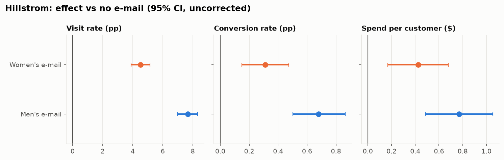

# Decision memo: Hillstrom e-mail campaign

*Generated by `case_studies/01_hillstrom.py` from `results/case_studies/hillstrom.json` (commit `5bab396`). Do not edit the numbers by hand.*

**Decision: LAUNCH, using the Mens E-Mail.** The primary metric is significant after Holm correction and the profit CI is above zero.

| | |
|---|---|
| Expected impact | $0.77 revenue per customer e-mailed (95% CI $0.49 to $1.05), which is $0.131 profit per customer after the assumed 30% margin and $0.10 e-mail cost. Over 1,000,000 customers: $130,948 (CI $45,542 to $216,354). |
| Main risk | Spend comes from the 1.25% of e-mailed customers who buy, so the revenue CI is wide. The profit sign depends on the margin and cost assumptions, which are inputs, not data. |
| Main assumptions | Randomization was intact (checked below). The 2-week window captures the effect (longer-term cannibalisation is not measured). The 2008 population resembles today's list. Margin and e-mail cost are as stated in `configs/hillstrom.yaml`. |

## 1. Is the experiment trustworthy?

- **Sample ratio:** Mens E-Mail: 21307, No E-Mail: 21306, Womens E-Mail: 21387. Chi-square SRM test p = 0.904 (threshold 0.001): **pass**.
- **Pre-experiment covariate balance:** the largest absolute standardized mean difference across recency, history, past categories, newbie flag, zip type and channel is 0.014 (rule of thumb: < 0.1): **pass**.

## 2. What was the effect, and how uncertain is it?

Control (no e-mail) rates: visit 10.62%, conversion 0.57%, spend $0.65 per customer.

| Arm | Metric | Effect vs control | 95% CI | p (raw) | p (Holm, 6 tests) |
|---|---|---|---|---|---|
| Mens E-Mail | spend | $0.770 | $0.485 to $1.055 | 1.2e-07 | 3.5e-07 |
| Mens E-Mail | visit | +7.66 pp | +7.00 pp to +8.32 pp | 5.7e-112 | 3.4e-111 |
| Mens E-Mail | conversion | +0.68 pp | +0.50 pp to +0.86 pp | 1.5e-13 | 6.1e-13 |
| Womens E-Mail | spend | $0.424 | $0.169 to $0.680 | 0.001 | 0.001 |
| Womens E-Mail | visit | +4.52 pp | +3.89 pp to +5.16 pp | 3.2e-44 | 1.6e-43 |
| Womens E-Mail | conversion | +0.31 pp | +0.15 pp to +0.47 pp | 0.00016 | 0.00031 |

**Variance reduction (CUPED).** Using past-year spend (`history`) as the pre-period covariate, CUPED reduced the variance of the spend outcome by 0.0% for the Mens E-Mail (correlation ρ = 0.021). The SE went from $0.1452 to $0.1452. Lin regression adjustment on all pre-period covariates gave SE $0.1451. **The reduction is negligible.** Two-week spend is barely correlated with past-year spend in this data, so CUPED is valid here but buys almost nothing; for visits it was 0.4%. CUPED pays off when a pre-period version of the *same* metric is available (see `results/validation/stage2.json`, where ρ = 0.88 gave a 75% reduction). Hillstrom has no such metric. The adjusted estimates ($0.767 CUPED, $0.767 Lin) agree with the unadjusted one, as they should under randomization.

**Sensitivity.** At 80% power this sample could detect a spend change of $0.315 per customer, a relative visit lift of 8.0% or a relative conversion lift of 39.1%.

## 3. What should the business do next?

- **Mens E-Mail: launch.** Profit per customer $0.131 (CI $0.046 to $0.216). The primary metric is significant after Holm correction and the profit CI is above zero.
- **Womens E-Mail: keep testing.** Profit per customer $0.027 (CI -$0.049 to $0.104). Revenue lift is real but profit CI straddles zero under the stated economics.

The decision rule is coded in `decide()` and was written before the script was first run: launch only if the primary metric survives Holm correction *and* the profit CI lies above zero.

**Limitations.** The 2008 data is public and well studied, so this is a methods demonstration, not a fresh result. Spend is a revenue metric, and the profit conversion relies entirely on the assumed margin. A segment-level targeting analysis (who benefits most) is shown on Criteo in case study 2.
