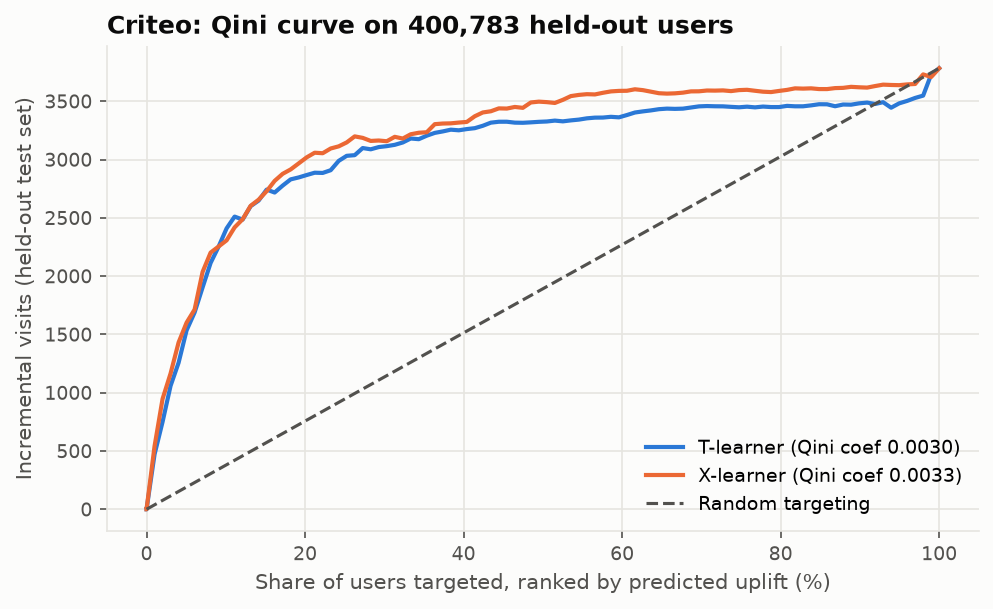
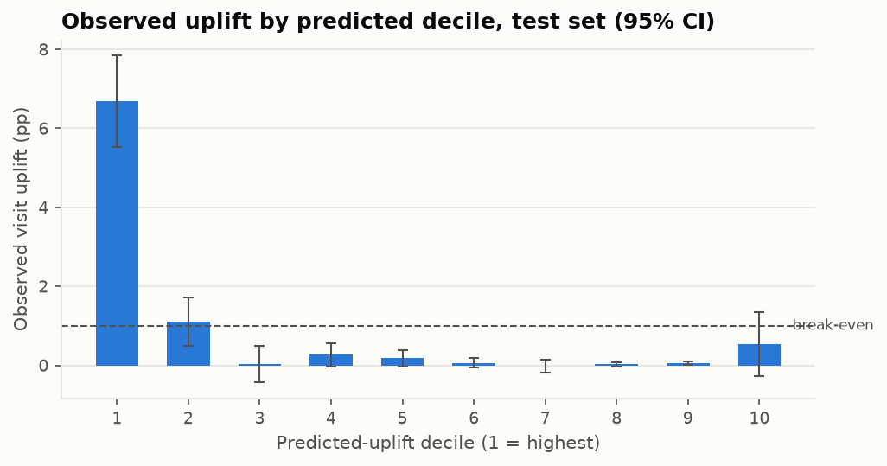

# Decision memo: who should see Criteo ads?

*Generated by `case_studies/02_criteo.py` from `results/case_studies/criteo.json` (commit `0e88098`). Do not edit the numbers by hand.*

**Decision: LAUNCH.** Targeting beats random at the chosen depth and is profitable on the held-out test set.

| | |
|---|---|
| Expected impact | Target the top 20% of users by predicted uplift (x-learner). Held-out profit is $6.74 per 1,000 eligible users (CI $5.43 to $8.05), against $0.22 for random targeting at the same depth and $1.10 for treating everyone. Model minus random: $5.35 to $7.69 per 1,000 (bootstrap 95% CI). |
| Main risk | The value depends on the cost/value assumptions, and the best depth moves with them (sensitivity table below). Features are anonymised, so the targeted segment can't be described in business terms or audited for fairness. |
| Main assumptions | An incremental visit is worth $1.00 and treating a user costs $0.01 (break-even uplift +1.00 pp). These are illustrative inputs, not data. Test-period behaviour carries over to deployment. |

## 1. Is the experiment trustworthy?

- **Sample ratio:** 150,076 control / 851,881 treated in the 1,001,957-row sample, tested against the documented 15%/85% split: p = 0.543, **pass**.
- **Feature balance:** max |SMD| across the 12 features = 0.046: **pass**.
- **Treatment is assignment, not exposure:** only 3.6% of treated users were actually exposed to an ad. Every effect here is an intent-to-treat effect of *being eligible for* ads.

## 2. Average effect

| Outcome | Control | Treated | Effect (ITT) | 95% CI |
|---|---|---|---|---|
| conversion | 0.204% | 0.319% | +0.115 pp | +0.088 pp to +0.140 pp |
| visit | 3.839% | 4.893% | +1.054 pp | +0.945 pp to +1.160 pp |

## 3. Who to target: uplift models on held-out data

Models were fit on a 400,782-user training split. The targeting depth was chosen on a 200,392-user validation split. Every number below comes from a 400,783-user test split the models never saw.

| Model | Qini coefficient | 95% bootstrap CI | Chosen depth | Test profit / 1,000 users |
|---|---|---|---|---|
| t-learner | 0.00297 | 0.00227 to 0.00353 | 30% | $6.06 |
| x-learner | 0.00326 | 0.00267 to 0.00387 | 20% | $6.74 |

A Qini coefficient of 0 means no better than random targeting. Ranked by the same x-learner visit model, the secondary outcome (conversion) has Qini 0.000336 (CI 0.000199 to 0.000498). The CI excludes 0, so the visit ranking also carries conversion signal. Qini coefficients are on the outcome's scale (conversions are 19x rarer than visits in control), so the two numbers are not directly comparable.

**Where the uplift sits.** The top decile alone shows +6.69 pp observed uplift, compared with +1.05 pp on average. Observed uplift in deciles 3-10 is never more than 0.54 pp away from zero, so the model mainly finds one responsive segment rather than a smooth gradient.

**Observed uplift by predicted decile (x-learner, test set):**

| Decile | Predicted | Observed | 95% CI |
|---|---|---|---|
| 1 | +5.10 pp | +6.69 pp | +5.54 pp to +7.84 pp |
| 2 | +0.61 pp | +1.10 pp | +0.49 pp to +1.72 pp |
| 3 | +0.26 pp | +0.03 pp | -0.44 pp to +0.49 pp |
| 4 | +0.20 pp | +0.27 pp | -0.02 pp to +0.55 pp |
| 5 | +0.16 pp | +0.18 pp | -0.04 pp to +0.39 pp |
| 6 | +0.15 pp | +0.06 pp | -0.06 pp to +0.19 pp |
| 7 | +0.14 pp | -0.02 pp | -0.17 pp to +0.14 pp |
| 8 | +0.14 pp | +0.02 pp | -0.04 pp to +0.09 pp |
| 9 | +0.14 pp | +0.05 pp | +0.01 pp to +0.10 pp |
| 10 | -0.25 pp | +0.54 pp | -0.27 pp to +1.35 pp |

## 4. Sensitivity of the decision to economics

The value per visit is held at $1 while the cost per treated user varies:

| Break-even uplift | Chosen depth | Test profit / 1,000 | Random at same depth / 1,000 | Treat all / 1,000 | Model − treat all |
|---|---|---|---|---|---|
| +0.25 pp | 50% | $8.93 | $4.30 | $8.60 | $0.33 |
| +0.50 pp | 50% | $7.68 | $3.05 | $6.10 | $1.58 |
| +1.00 pp | 20% | $6.74 | $0.22 | $1.10 | $5.64 |
| +1.50 pp | 20% | $5.74 | -$0.78 | -$3.90 | $9.64 |
| +2.00 pp | 10% | $4.69 | -$0.89 | -$8.90 | $13.59 |
| +3.00 pp | 10% | $3.69 | -$1.89 | -$18.90 | $22.59 |

**Reading it:** targeting earns its keep when treatment is expensive. At a +0.25 pp break-even, the model beats treating everyone by only $0.33 per 1,000 users (no CI computed for this difference). If ads are that cheap, treating everyone is the simpler policy and gives up little.

## Limitations

- A seeded 1,001,957-row sample (7.2% of the 13,979,592 rows) is used for speed. The full file would tighten every CI.
- The features are anonymised projections, so the targeting rule can't be explained or checked for proxy discrimination.
- Uplift is modelled on *visits*. A conversion-value business case needs a model trained on conversions (0.3% base rate), which would need far more data per segment.
- The data is CC BY-NC-SA 4.0, so these results are for non-commercial use.
