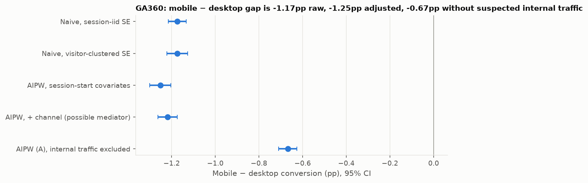
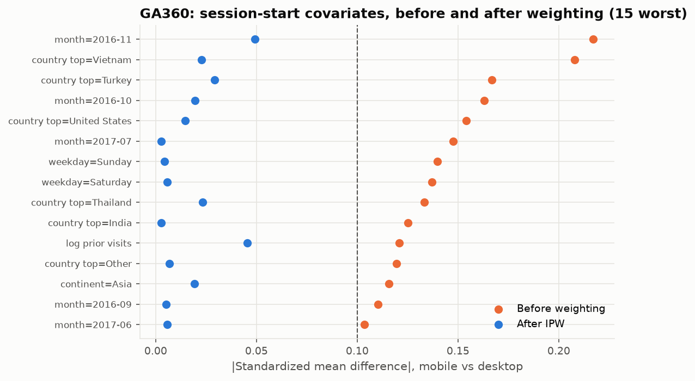

# Technical appendix: mobile vs desktop conversion (observational)

*Generated by `case_studies/03_ga360.py` from `results/case_studies/ga360.json` (commit `4be219f`). Do not edit the numbers by hand.*

The one-page decision is in [03_ga360.md](03_ga360.md). This appendix holds the full evidence behind it.

## What changed versus the original analysis

1. **Standard errors.** There are 1.27 sessions per visitor, so 21.0% of sessions are a visitor's second or later session in the window. Clustering by `fullVisitorId` widens the naive SE by a factor of 1.16. The original CI treated every session as independent.
2. **Confounding adjustment** with propensity scores, using only covariates fixed at session start (month, weekday, UTC time block, continent, top-10 country, returning-visitor flag and prior-visit count). In-session behaviour (pageviews, time on site, bounces) was **never pulled**: it is downstream of the device and would bias the estimate.
3. **Suspected internal traffic** is excluded in a *post-hoc* sensitivity run. The hypothesis came from the initial audit of channel-level rates, before this analysis was written, but it is still a data-driven exclusion, so the full-data estimate stays the primary one. One segment stands out. Channel "Referral" with the source recorded as "(direct)" has 68,468 desktop sessions but only 442 mobile ones. It converts at 7.5% on desktop and holds **5,129 conversions**. In total, the excluded traffic carries 49.1% of all desktop conversions. The pattern fits employee or internal purchasing with an obfuscated referrer, but the sample can't confirm the origin. It also drives a large share of the raw "desktop converts better" result.
4. **Sensitivity to unmeasured confounding** via an E-value.

## Estimates (mobile − desktop conversion probability)

| Estimator | Estimate | 95% CI |
|---|---|---|
| Naive, session-iid SE (original method) | -1.174 pp | -1.215 pp to -1.133 pp |
| Naive, visitor-clustered SE | -1.174 pp | -1.221 pp to -1.127 pp |
| IPW, set A (session start) | -1.240 pp | -1.288 pp to -1.193 pp |
| **AIPW, set A (session start), primary** | **-1.252 pp** | **-1.300 pp to -1.204 pp** |
| AIPW, set B (+ channel, possible mediator) | -1.219 pp | -1.263 pp to -1.175 pp |
| Naive, internal traffic excluded (clustered SE) | -0.495 pp | -0.538 pp to -0.452 pp |
| **AIPW, set A, internal traffic excluded** | **-0.668 pp** | **-0.710 pp to -0.626 pp** |

All adjusted SEs are clustered by visitor. Excluding the suspected internal segment, the risk ratio is 0.326 (CI 0.299 to 0.356). On the full data the primary estimate is RR = 0.230 (CI 0.211 to 0.251): mobile sessions convert at about 23% of the rate of comparable desktop sessions.

## Diagnostics

- **Overlap (set A):** 3.0% of sessions have propensity outside [0.05, 0.95]. Propensity AUC = 0.666. Effective sample sizes: 155,659 (mobile) and 650,133 (desktop). Overlap flag: **adequate**.
- **Balance (set A, 40 indicators):** max |SMD| 0.217 before weighting and 0.049 after. Balance on *measured* covariates says nothing about unmeasured ones.

## What remains unidentified

- **Purchase intent.** People may browse on phones and buy on desktops. Cross-device journeys are invisible here, because the same person on two devices has two `fullVisitorId`s (no visitor appears on both devices in this data). A mobile session that leads to a later desktop purchase counts as a mobile non-conversion. That alone can produce a gap with **zero** causal effect of the mobile experience.
- **Channel** may be partly caused by device (social apps on phones), so set B can understate the total device-associated gap. The primary set A leaves it out on purpose. The two estimates bracket the ambiguity.
- **E-value:** to explain away the adjusted association entirely, an unmeasured confounder would need a risk-ratio association of **8.17** with both device and conversion beyond the measured covariates. To move the CI to include no effect, it would need **7.44**. Without suspected internal traffic these fall to 5.58 and 5.06. The bar is two associations at once. Purchase intent's association with conversion is plausibly far above 8, since intent is close to what conversion measures. Its association with device choice is the open question. So a large E-value here **does not** make the causal reading safe; it says the confounder would have to differ strongly between mobile and desktop users.

## What to do next

Run a randomized test of a **specific** mobile change (e.g. checkout flow), randomized by visitor. At the observed mobile conversion rate of 0.41% and about 16,056 mobile sessions a month:

| Relative lift to detect | Sessions per arm | Months of all mobile traffic |
|---|---|---|
| 10% | 400,178 | 49.8 |
| 25% | 68,580 | 8.5 |
| 50% | 19,040 | 2.4 |

These counts are sessions and assume independent sessions. Randomizing by visitor (as recommended) adds a design effect from repeat visits, so the real requirement is somewhat larger. The variance inflation from clustering seen above (×1.35) is a rough guide. A subtle change is not testable at current traffic. Test a bold change (25-50% target lift), use a higher-frequency primary metric (e.g. add-to-cart), or use CUPED with each visitor's pre-period activity to cut the sample needed. Randomizing by visitor also means the analysis must cluster by visitor, as above.
